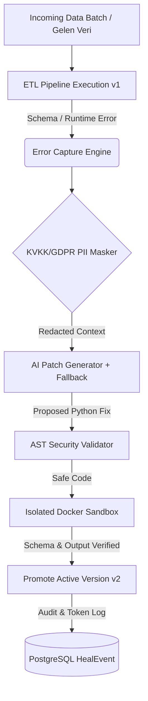

# AutoHeal Pipeline 🛡️⚙️

**[EN]**  
**AutoHeal Pipeline** is a multi-tenant, autonomous ETL & schema self-healing SaaS platform designed to detect, analyze, and automatically patch runtime failures in production data pipelines. It protects sensitive personal data (KVKK/GDPR) before LLM inference and validates every AI-generated Python fix inside an isolated, network-disabled Docker sandbox before zero-downtime deployment.

**[TR]**  
**AutoHeal Pipeline**, üretim veri hatlarındaki (ETL) çalışma zamanı ve şema hatalarını tespit eden, analiz eden ve otonom olarak onaran çok kiracılı (multi-tenant) bir SaaS platformudur. Yapay zeka modeline veri göndermeden önce hassas kişisel verileri (KVKK/GDPR) maskeler ve üretilen her Python yamasını canlı ortama almadan önce ağ erişimi kapalı, izole bir Docker Sandbox konteynerinde test ederek sıfır kesintiyle devreye alır.

---

## 🎥 Live Demo (Loom Walkthrough)
> 🔗 **[Watch the 100-Second Architecture & Live Self-Healing Demo on Loom](https://www.loom.com/share/f3cca1ea7a93419f9c493e46d6de3b05)**

---

## ✨ Key Enterprise Features / Temel Kurumsal Özellikler

* **Multi-Tenant Isolation / Çok Kiracılı İzolasyon:** Strict `tenant_id` data segregation with localized (`EN` / `TR`) root-cause explanations (`heal_reason`).
* **KVKK & GDPR PII Redaction / Kişisel Veri Maskeleme:** Automatically detects and masks National IDs (TCKN), IBANs, Credit Cards, Emails, and Phone numbers before any error context reaches the LLM.
* **Zero-Trust Docker Sandbox / Sıfır Güvenli Docker Sandbox:** Validates AI-generated Python patches via AST static security checks and executes them inside an ephemeral, network-disabled (`network_mode="none"`), CPU/RAM-capped container.
* **Intelligent Fallback Resilience / Akıllı Kurtarma Katmanı:** Ensures uninterrupted pipeline recovery even during external LLM API rate-limit or quota disruptions.
* **FinOps Token Auditing / Token Maliyet Takibi:** Records exact `prompt_tokens`, `completion_tokens`, and version diffs per healing event for transparent cost governance.

---

## 🏗️ System Architecture / Sistem Mimarisi



---

## 🚀 Setup & Installation / Kurulum ve Çalıştırma

### 1. Environment Configuration / Ortam Değişkenleri
Copy `.env.example` to `.env` and configure your database and LLM credentials:  
`.env.example` dosyasını `.env` olarak kopyalayın ve veritabanı ile LLM anahtarlarınızı girin:

```bash
cp .env.example .env
```

### 2. Launch with Docker / Docker ile Başlatma
Start PostgreSQL, build the isolated sandbox image, and run the FastAPI service:  
PostgreSQL veritabanını, izole sandbox imajını ve FastAPI servisini tek komutla ayağa kaldırın:

```bash
docker-compose up -d --build
```

### 3. Automated Tests / Otomatik Testler
Run the end-to-end test suite inside the container:  
Uçtan uca test paketini konteyner içinde çalıştırın:

```bash
docker-compose run --rm api pytest -v
```

---

## ⚡ 1-Click Live Demo / Tek Tıkla Canlı Demo (`http://localhost:8000/docs`)

**[EN]**  
Want to see AutoHeal in action without manual configuration?  
1. Open **`http://localhost:8000/docs`** and execute **`POST /api/v1/demo/setup`** to automatically provision a sample enterprise tenant and a fragile ETL pipeline (`v1`) expecting clean numeric currency values.  
2. Execute **`POST /api/v1/pipelines/{pipeline_id}/execute`** using the generated IDs to send corrupted text-based prices (e.g., `"1.500,00 TL"`) alongside sensitive PII (`tckn`, `email`).  
3. Watch the system redact personal data, generate a Python fix, verify it inside the isolated Docker sandbox (`"sandbox_test_passed": true`), and promote `v2` automatically.  
4. Inspect **`GET /api/v1/pipelines/{pipeline_id}/heal-events`** for full root-cause explanations and audit logs.

**[TR]**  
Manuel kurulumla uğraşmadan sistemin otonom onarım yeteneğini görmek ister misiniz?  
1. Tarayıcınızda **`http://localhost:8000/docs`** adresini açın ve **`POST /api/v1/demo/setup`** uç noktasını çalıştırarak örnek bir kurumsal müşteri hesabı ile yalnızca temiz sayısal değerler bekleyen hassas bir ETL veri hattı (`v1`) oluşturun.  
2. Oluşan ID'leri kullanarak **`POST /api/v1/pipelines/{pipeline_id}/execute`** uç noktasına kişisel veriler (`tckn`, `email`) içeren bozuk metin formatlı tutarlar (`"1.500,00 TL"`) gönderin.  
3. Sistemin kişisel verileri maskelemesini, hata onarımı için yeni Python kodu üretmesini, izole Docker Sandbox içinde test edip doğrulamasını (`"sandbox_test_passed": true`) ve sıfır kesintiyle `v2` sürümünü devreye almasını canlı izleyin.  
4. **`GET /api/v1/pipelines/{pipeline_id}/heal-events`** uç noktasından kök neden açıklamasını ve denetim kayıtlarını inceleyin.

---

## 🛠️ Tech Stack / Teknoloji Yığını

* **Backend & API:** Python 3.11, FastAPI, Pydantic v2, Uvicorn
* **Database & ORM:** PostgreSQL 15, SQLAlchemy 2.0
* **Data Processing:** Pandas
* **Security & Isolation:** Docker SDK (Ephemeral Sandboxes), Python `ast` Static Analyzer, Regex PII Masker
* **AI Engine:** OpenAI-Compatible LLM Client (Gemini / OpenAI) with Deterministic Fallback
* **Testing:** Pytest
